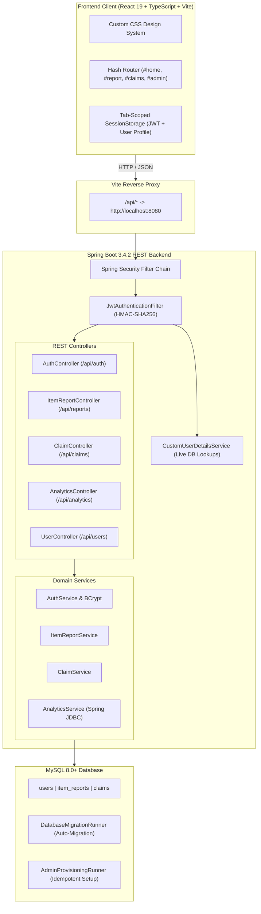

<div align="center">

# 🏛️ Campus Lost & Found Portal
### University Property Desk Management & Ownership Claim System

[](https://spring.io/projects/spring-boot)
[](https://www.oracle.com/java/)
[](https://spring.io/projects/spring-security)
[](https://jwt.io/)
[](https://react.dev/)
[](https://www.typescriptlang.org/)
[](https://vitejs.dev/)
[](https://www.mysql.com/)
[](#-automated-testing--verification)

<p align="center">
  A production-ready, full-stack campus property tracking application built with <strong>Spring Boot 3</strong>, <strong>Spring Security 6</strong>, and <strong>React 19</strong>. Designed for high accountability, role-based workflows, automated database migrations, and real-time unclaimed property analytics.
</p>

[Key Features](#-core-capabilities) • [Architecture](#-system-architecture) • [Security & Auth](#-security--authentication-architecture) • [API Guide](#-rest-api-documentation) • [Quickstart](#-quickstart-guide) • [Tests](#-automated-testing--verification)

---

</div>

## 🌟 Core Capabilities

<table>
  <tr>
    <td width="50%">
      <h3>🛡️ Robust Security & Identity</h3>
      <ul>
        <li><strong>Stateless JWT Bearer Authentication</strong> with HMAC-SHA256 signing and 30-minute auto-expiry.</li>
        <li><strong>Role-Based Access Control (RBAC)</strong> enforcing <code>ROLE_STUDENT</code> and <code>ROLE_ADMIN</code> boundaries.</li>
        <li><strong>Server-Side Identity Binding</strong>: Claimants and reporters are strictly resolved from authenticated principals.</li>
        <li><strong>Live Account Validity</strong>: Demoted roles or disabled accounts take effect immediately, neutralizing stale tokens.</li>
      </ul>
    </td>
    <td width="50%">
      <h3>🔍 Lost & Found Catalog</h3>
      <ul>
        <li><strong>Smart Filtering</strong>: Real-time discovery across <code>ALL</code>, <code>LOST</code>, and <code>FOUND</code> items.</li>
        <li><strong>Multi-Field Search</strong>: Query items by title keyword, category, or university location.</li>
        <li><strong>Detailed Inspection View</strong>: View item attributes, reporting student identity, timestamps, and claim readiness.</li>
        <li><strong>Editorial Custom CSS</strong>: Zero third-party component libraries; custom accessible design tokens.</li>
      </ul>
    </td>
  </tr>
  <tr>
    <td width="50%">
      <h3>🤝 Claim Verification Workflow</h3>
      <ul>
        <li><strong>Self-Claim Prevention</strong>: Prevents users from claiming items they personally reported.</li>
        <li><strong>Duplicate Claim Lock</strong>: Eliminates repeat claim submissions per user on the same report.</li>
        <li><strong>Isolated Student Claims View</strong>: Students inspect approval progress exclusively for their own claims.</li>
        <li><strong>Status Lifecycle</strong>: Strict transitions from <code>PENDING</code> &rarr; <code>APPROVED</code> / <code>REJECTED</code> &rarr; <code>RETURNED</code>.</li>
      </ul>
    </td>
    <td width="50%">
      <h3>📊 Admin Dashboard & Visual Analytics</h3>
      <ul>
        <li><strong>High-Performance Aggregations</strong> powered by optimized Spring JDBC Template queries.</li>
        <li><strong>Unclaimed Property Distribution</strong>: Visual metrics by building/location and item category.</li>
        <li><strong>Claim Review Panel</strong>: Approve and reject student ownership claims with one click.</li>
        <li><strong>Return Processing</strong>: Handover verification marking claimed items as officially returned.</li>
      </ul>
    </td>
  </tr>
</table>

---

## 🏗️ System Architecture



---

## 🔒 Security & Authentication Architecture

> [!IMPORTANT]
> **Zero Unauthenticated Writes**: Creating reports, updating records, submitting claims, and accessing administration endpoints strictly require valid JWT bearer credentials.

```
Incoming Request
       │
       ▼
┌──────────────────────────────┐
│  JwtAuthenticationFilter     │ ──▶ Validates HMAC-SHA256 signature & expiration
└──────────────────────────────┘
       │
       ▼
┌──────────────────────────────┐
│  CustomUserDetailsService    │ ──▶ Queries database for live role & account status
└──────────────────────────────┘
       │
       ├── Account Disabled / Locked ──▶ 401 Unauthorized
       ├── Account Deleted           ──▶ 401 Unauthorized
       │
       ▼
┌──────────────────────────────┐
│  SecurityContextHolder       │ ──▶ Binds live UserPrincipal (Student vs Admin)
└──────────────────────────────┘
       │
       ├── Student accessing /api/analytics/** ──▶ 403 Forbidden
       ├── Student modifying other user report ──▶ 403 Forbidden
       └── Valid permission verified           ──▶ 200 / 201 Success
```

### Security Highlights
- **Dual-Identifier Login**: Authenticate with either **College UID** (e.g. `24BCS10586`) or **Campus Email** (e.g. `student@campus.edu`).
- **Tab-Scoped Session Storage**: Tokens are kept in `sessionStorage` rather than `localStorage`. Closing the browser tab destroys the token, shielding shared campus workstations.
- **Admin Provisioning Guard**: The initial administrator account is bootstrapped via a safe, idempotent startup runner [`AdminProvisioningRunner.java`](file:///E:/Projects/Campus%20Lost%20&%20Found%20Portal/src/main/java/com/campus/lostfound/config/AdminProvisioningRunner.java). Conflicting student accounts are never silently promoted.
- **Legacy Account Linking Guard**: Public registration matching an uncredentialed historical account is blocked to prevent account takeovers. Linking requires administrator authorization via `POST /api/users/{id}/link-legacy`.

---

## 📡 REST API Documentation

| Method | Endpoint | Access Level | Description |
|---|---|---|---|
| `POST` | `/api/auth/register` | Public | Registers a student (`collegeUid`, `name`, `email`, `password` $\ge 12$). |
| `POST` | `/api/auth/login` | Public | Authenticates via UID/Email + password; returns JWT bearer token. |
| `GET` | `/api/auth/me` | Authenticated | Retrieves current authenticated session user profile. |
| `GET` | `/api/reports` | Public | Catalogs all reports with optional `type` and `status` query params. |
| `GET` | `/api/reports/{id}` | Public | Detailed report inspection by primary key. |
| `GET` | `/api/reports/search` | Public | Searches catalog by category and/or campus location keywords. |
| `POST` | `/api/reports` | Authenticated | Files a `LOST` or `FOUND` report; reporter bound from token. |
| `PUT` | `/api/reports/{id}` | Owner / Admin | Updates item title, category, location, and description. |
| `PATCH` | `/api/reports/{id}/returned` | **Admin Only** | Marks a claimed report as officially `RETURNED`. |
| `POST` | `/api/claims` | Authenticated | Submits an ownership claim against an eligible found item. |
| `GET` | `/api/claims` | Authenticated | Retrieves own claims (students) or filtered claims (administrators). |
| `GET` | `/api/claims/{id}` | Owner / Admin | Retrieves claim details by ID. |
| `PATCH` | `/api/claims/{id}/approve` | **Admin Only** | Approves claim and automatically transitions item to `CLAIMED`. |
| `PATCH` | `/api/claims/{id}/reject` | **Admin Only** | Rejects an ownership claim. |
| `GET` | `/api/analytics/**` | **Admin Only** | Aggregations by location, category, and unclaimed item details. |
| `POST` | `/api/users/{id}/link-legacy` | **Admin Only** | Assigns credentials to an unlinked historical account. |

---

## 🚀 Quickstart Guide

### 1. Prerequisites
- **Java**: JDK 21+ (`java -version`)
- **Node.js**: v18+ (`node -v`)
- **Database**: MySQL Server 8.0+ on port `3306`

### 2. Database Initialization
```sql
CREATE DATABASE campus_lost_found CHARACTER SET utf8mb4 COLLATE utf8mb4_unicode_ci;
```
Import base tables:
```bash
mysql -u root -p campus_lost_found < database/schema.sql
```
*(Authentication columns `college_uid`, `password_hash`, `role`, and `enabled` are migrated automatically on startup).*

### 3. Start the Backend API
From the repository root:
```powershell
# Set your MySQL root password
$env:DB_PASSWORD="your_mysql_password"

# Optional: Enable admin provisioning for initial setup
$env:ADMIN_PROVISION_ENABLED="true"

# Launch Spring Boot
.\mvnw.cmd spring-boot:run
```
Backend API will listen at **`http://localhost:8080`**.

> [!TIP]
> **Default Admin Credentials**:
> - **Identifier**: `ADMIN001` or `admin@campus.edu`
> - **Password**: `Admin@Campus2026!`

### 4. Start the Frontend Application
From the `frontend/` directory in a second terminal:
```powershell
cd frontend
npm install
npm run dev
```
Open **`http://localhost:5173`** in your browser. The Vite proxy forwards all `/api/*` calls directly to the Spring Boot service.

---

## 🧪 Automated Testing & Verification

The test suite covers unit, integration, and security layer constraints:

```powershell
.\mvnw.cmd test
```

### Test Suite Breakdown (53/53 Passing)

| Test Suite | Tests | Purpose |
|---|:---:|---|
| [`SecurityAuthorizationTest`](file:///E:/Projects/Campus%20Lost%20&%20Found%20Portal/src/test/java/com/campus/lostfound/controller/SecurityAuthorizationTest.java) | **13** | Validates 401 unauthenticated writes, 403 student restrictions, 200 admin operations, and public browsing. |
| [`AuthServiceTest`](file:///E:/Projects/Campus%20Lost%20&%20Found%20Portal/src/test/java/com/campus/lostfound/service/AuthServiceTest.java) | **12** | Registration, duplicate checks, dual UID/Email login, BCrypt hashing, and legacy account safety. |
| [`JwtServiceTest`](file:///E:/Projects/Campus%20Lost%20&%20Found%20Portal/src/test/java/com/campus/lostfound/security/JwtServiceTest.java) | **7** | Signature checks, expiration validation, disabled accounts, and stale token role neutralization. |
| [`ClaimServiceTest`](file:///E:/Projects/Campus%20Lost%20&%20Found%20Portal/src/test/java/com/campus/lostfound/service/ClaimServiceTest.java) | **8** | Self-claims, duplicate claims, eligible status validation, approvals, and rejections. |
| [`AdminProvisioningRunnerTest`](file:///E:/Projects/Campus%20Lost%20&%20Found%20Portal/src/test/java/com/campus/lostfound/config/AdminProvisioningRunnerTest.java) | **5** | Startup conflict prevention, idempotent restarts, and student elevation blocks. |
| [`ItemReportServiceTest`](file:///E:/Projects/Campus%20Lost%20&%20Found%20Portal/src/test/java/com/campus/lostfound/service/ItemReportServiceTest.java) | **4** | Report lifecycles, searches, status transitions, and update rules. |
| [`UserServiceTest`](file:///E:/Projects/Campus%20Lost%20&%20Found%20Portal/src/test/java/com/campus/lostfound/service/UserServiceTest.java) | **4** | Core user entity retrieval and email collision checks. |

---

## 📁 Project Directory Structure

```
Campus Lost & Found Portal/
├── database/
│   ├── schema.sql                         # Baseline MySQL 8 schema
│   └── migration_v2_auth.sql              # Non-destructive authentication migration
├── frontend/
│   ├── src/
│   │   ├── components/
│   │   │   ├── admin/AdminDashboard.tsx   # Visual analytics & claims review panel
│   │   │   ├── auth/LoginPage.tsx         # Dual UID/Email authentication form
│   │   │   ├── auth/RegisterPage.tsx      # Student self-registration with confirmation
│   │   │   ├── claims/ItemDetailsView.tsx # Item inspection & ownership claim filing
│   │   │   ├── claims/MyClaimsView.tsx    # Authenticated student claims status
│   │   │   ├── home/BrowseSection.tsx     # Catalog search and LOST/FOUND filters
│   │   │   ├── layout/SiteHeader.tsx      # Role-aware responsive navigation bar
│   │   │   ├── report/ReportForm.tsx      # Property loss/find submission workflow
│   │   │   └── ui/                        # Reusable primitives (Card, Badge, Button, Input)
│   │   ├── services/                      # REST API client services (reports, claims, auth)
│   │   ├── styles/                        # Custom CSS tokens and global design system
│   │   └── types/                         # TypeScript interfaces (auth, report, claim)
│   ├── package.json
│   └── vite.config.ts
├── src/
│   ├── main/java/com/campus/lostfound/
│   │   ├── config/                        # SecurityConfig, DatabaseMigrationRunner, AdminRunner
│   │   ├── controller/                    # Spring MVC REST Controllers
│   │   ├── dto/                           # Request & Response DTO payloads
│   │   ├── entity/                        # JPA Entities (User, ItemReport, Claim, Role)
│   │   ├── exception/                     # GlobalExceptionHandler (RFC-7807 responses)
│   │   ├── repository/                    # Spring Data JPA Repositories
│   │   ├── security/                      # JWT Service, AuthenticationFilter, UserPrincipal
│   │   └── service/                       # Business logic & Spring JDBC Analytics
│   └── main/resources/
│       └── application.properties         # Configurable database, JWT, and admin properties
├── pom.xml                                # Maven dependencies & build configuration
└── README.md
```

---

<div align="center">

**Developed with paired programming on Google Antigravity**  
Campus Lost & Found Portal • University Property Desk System

</div>
